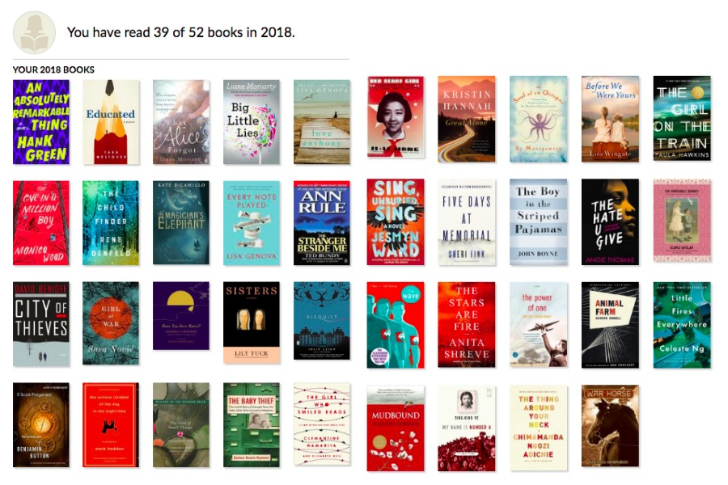

# Goodreads Classic Reading Challenge

A Chrome extension that brings back the compact book-cover grid on Goodreads reading challenge pages.

## Install

1. [Download the extension](https://github.com/majolo/goodreads/archive/refs/heads/main.zip) and unzip it.
2. Open `chrome://extensions` in Chrome and turn on **Developer mode**.
3. Click **Load unpacked** and select the unzipped `goodreads-main` folder.
4. Open your Goodreads reading challenge and reload the page.

Keep the folder where it is while the extension is installed. To restore the usual layout, disable or remove the extension and reload Goodreads.

## Privacy

Runs only on Goodreads annual reading challenge pages. Check [manifest.json](manifest.json) to see which pages it can access. No analytics, data collection, or external requests.

If the layout breaks, [open an issue](https://github.com/majolo/goodreads/issues). This is an unofficial extension, not affiliated with Goodreads.

[MIT license](LICENSE).
